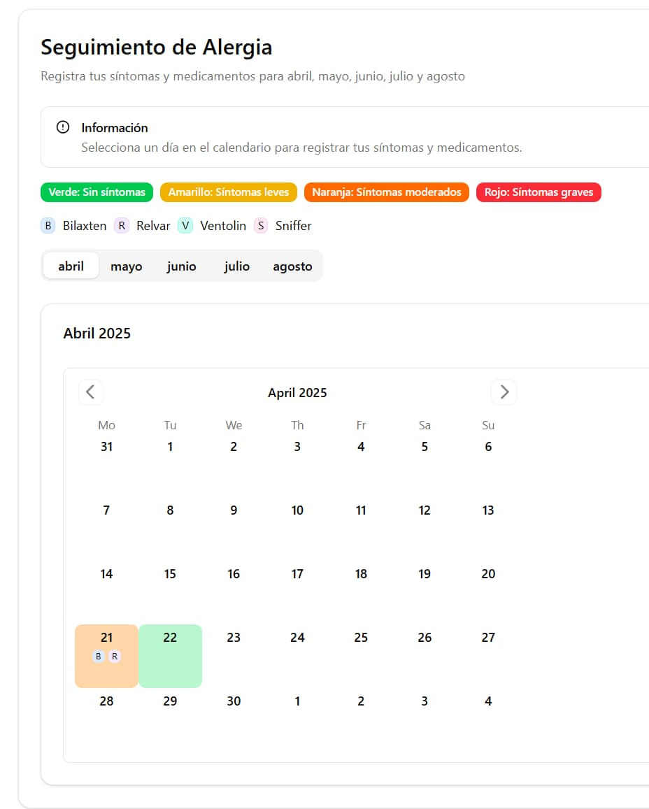

# Alergia Next.js

Esta aplicación te ayuda a llevar un registro diario de síntomas de alergia y medicación tomada. Permite visualizar tu historial de síntomas, registrar medicamentos y analizar patrones para un mejor control de tu salud.

## Características principales

- Calendario interactivo para seleccionar días y ver información detallada.
- Registro de niveles de síntomas diarios (verde, amarillo, naranja, rojo).
- Añade y visualiza medicamentos tomados cada día (badges compactos por día).
- Gestión de citas pendientes con modal dedicado.
- Modo claro/oscuro con conmutador junto al título y persistencia de preferencia.
- Exporta la vista como JPG del mes activo con un clic.
- Datos sincronizados en Neon (PostgreSQL), con acceso protegido por contraseña.
- Interfaz moderna, accesible y responsiva.



## Instalación y ejecución

1. Clona el repositorio:

```bash
git clone https://github.com/efe13dev/alergias-nextjs.git
cd alergias-nextjs
```

2. Instala las dependencias:

```bash
bun install
```

3. Configura Neon y las variables de entorno siguiendo la sección «Persistencia de datos».

4. Ejecuta la aplicación en modo desarrollo:

```bash
bun run dev
```

Abre [http://localhost:3000](http://localhost:3000) en tu navegador para ver la app.

## Tecnologías usadas

- [Next.js](https://nextjs.org/)
- React
- TypeScript
- Tailwind CSS
- [Oxlint](https://oxc.rs/docs/guide/usage/linter.html) y [Oxfmt](https://oxc.rs/docs/guide/usage/formatter.html) (lint y formato)

## Uso rápido

- Haz clic en un día del calendario para abrir el editor.
- Selecciona el nivel de síntomas (verde/amarillo/naranja/rojo) y marca los medicamentos tomados.
- Los cambios se guardan automáticamente en Neon.
- Usa el botón “Citas pendientes” para gestionar recordatorios de citas.
- Pulsa “Exportar como JPG” para guardar una imagen del calendario del mes activo.

## Modo claro/oscuro

- Usa el icono de sol/luna a la derecha del título “Seguimiento de Alergia”.
- La preferencia se recuerda (localStorage) y se detecta el tema del sistema.
- Paleta oscura afinada para mejor contraste y legibilidad; modo claro conserva los colores clásicos.

## Persistencia de datos

1. Crea un proyecto gratuito en [Neon](https://neon.com/) y ejecuta el contenido de
   `schema.sql` en su editor SQL.
2. Copia la cadena de conexión de Neon en `.env.local` como `DATABASE_URL`.
3. Genera una contraseña larga y aleatoria, por ejemplo con `openssl rand -hex 32`,
   y guárdala en `.env.local` como `APP_PASSWORD`. Debe tener al menos 32 caracteres
   ASCII sin espacios. El usuario de acceso es `usuario`.
4. Añade ambas variables también en la configuración del proyecto de Vercel y
   vuelve a desplegar. No las publiques ni las añadas al repositorio.

Abre la aplicación **primero en el navegador que contiene tus datos anteriores**.
Si la base está vacía, se importan las claves `allergyTrackerData` y
`pendingAppointments` de ese navegador. Las claves originales no se borran.
Comprueba los datos importados antes de usar otros dispositivos; si ya hay datos en
Neon, no se sobrescriben automáticamente con los del navegador. Si tienes datos
diferentes en varios navegadores, la importación no los fusiona.

La app muestra los errores de guardado y permite descargar una copia de los datos
visibles. Si dos dispositivos modifican los mismos datos a la vez, se avisa de un
conflicto en lugar de sobrescribir los cambios: descarga la copia antes de recargar.
Haz copias de seguridad independientes; `localStorage` conserva únicamente los
datos anteriores a la migración, no una copia actualizada.

La contraseña protege la web y la API mediante HTTP Basic. Usa HTTPS fuera de
localhost y una contraseña aleatoria fuerte: esta protección no incluye limitación
de intentos. Los datos de salud requieren especial cuidado; quien conozca la
contraseña podrá verlos y modificarlos.

En modo desarrollo no se pide contraseña; `bun run dev` limita el servidor a
`127.0.0.1`. Los datos de ejemplo se cargan desde `src/app/api/data/dev-data.json`
sin conectar con Neon. Los cambios se guardan en memoria y se pierden al reiniciar
el servidor o recargar el módulo. No expongas el servidor de desarrollo a la red.

## Exportar como JPG

- Botón “Exportar como JPG” en la tarjeta superior.
- Genera una imagen JPG de la vista actual adaptando colores para una mejor legibilidad.

## Scripts disponibles

```bash
# Desarrollo (Turbopack)
bun run dev

# Build de producción
bun run build

# Servir build de producción
bun run start

# Ejecutar tests
bun test

# Lint (Oxlint)
bun run lint

# Lint con autofix
bun run lint:fix

# Formatear con Oxfmt (incluye orden de imports y clases Tailwind)
bun run format
```

## Estructura del proyecto (resumen)

```
src/
  app/
    page.tsx                # Pantalla principal con calendario, leyendas y exportación JPG
  components/
    CalendarDayButton.tsx   # Botón de día, niveles de síntomas, badges de medicación y barra de acento
    day-editor.tsx          # Editor del día (síntomas/medicación)
    AppointmentManager.tsx  # Gestión de citas pendientes
    ThemeToggle.tsx         # Conmutador de tema
    theme-provider.tsx      # Proveedor de tema y persistencia
  lib/
    utils.ts                # Utilidades de clases y colores por nivel
```

## Resolución de problemas

- Puerto ocupado: ejecuta con otro puerto `PORT=3001 bun run dev` y abre `http://localhost:3001`.
- Estilos: asegúrate de haber instalado dependencias y reinicia `bun run dev`.
- Si la importación falla, conserva las claves de localStorage y revisa sus datos antes de modificarlas.
- Exportación JPG: si no funciona en móvil, prueba en escritorio y con permisos de descarga.

## Contribuir

¡Las contribuciones son bienvenidas! Puedes abrir issues o pull requests para sugerir mejoras o reportar problemas.

## Licencia

MIT
